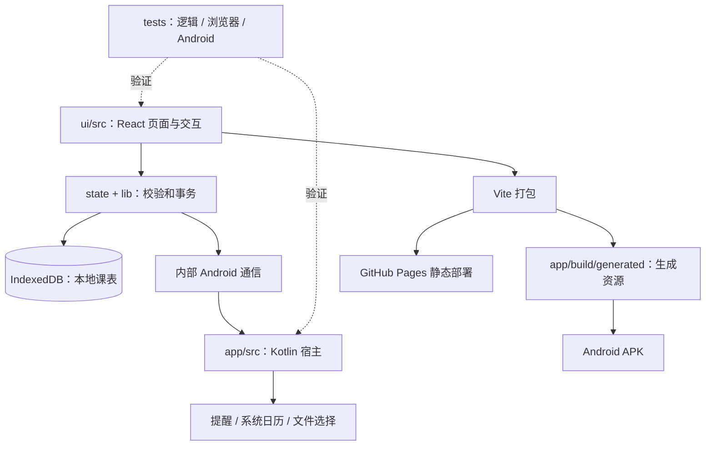

# 架构与目录职责

Dolphin Schedule 采用单 Android 模块与一套共用 React 界面。Android App 是主要产品，同时通过 GitHub Pages 提供浏览器访问；网页与 APK 共用源码，不维护额外的网页代码副本，不提供 PWA、Service Worker 或双击离线 HTML。

## 技术栈

| 层级 | 技术 | 职责 |
|---|---|---|
| 界面 | React / React DOM 19.1.1、TypeScript 5.9.2、CSS | 页面、组件、主题和交互 |
| 界面构建 | Vite 7、npm、Node.js 24 | 本地开发、类型检查、资源打包 |
| Android 宿主 | Kotlin 2.0.21、AndroidX WebKit 1.12.1、Core 1.15.0 | WebView、安全资源加载、原生能力 |
| Excel 解析 | @e965/xlsx 0.20.3 | 延迟加载的 XLS / XLSX 文件导入 |
| 本地持久化 | IndexedDB、SharedPreferences | 业务数据、提醒调度镜像与更新状态 |
| Android 构建 | Gradle 8.13、AGP 8.13.0、JDK / JVM target 17 | APK、资源处理、lint |
| 平台范围 | minSdk 26、compileSdk / targetSdk 36 | Android 8.0 起 |
| 测试 | Node test runner、tsx、Playwright、JUnit 4、Android lint | 逻辑、界面和宿主验证 |

精确 npm 版本以 `package.json` 和 `package-lock.json` 为准；Android 版本以 Gradle 配置为准。`md-card`、`md-dialog` 是项目自定义 Web 元素，界面不使用 Compose。

## 目录

| 路径 | 用途与边界 |
|---|---|
| `app/src/main/java/com/dolphin/schedule/` | Kotlin 宿主及系统能力、更新检查和原生导航，不复制 React 的课程编辑业务逻辑 |
| `MainActivity.kt` | WebView 初始化、原生通信、返回手势、权限与系统选择器 |
| `ReminderScheduler.kt` | 原生课表镜像、课次计算、AlarmManager 和重启恢复 |
| `Notifications.kt`、`LiveNotificationSupport.kt` | 课前提醒、持续行程和实时通知能力检查 |
| `CalendarSync.kt`、`SystemHolidays.kt` | 应用自己的课程日历写入/复原、选择来源后的节假日读取 |
| `app/src/main/res/` | Android 主题、单色通知图标、通知彩图与 XML 资源 |
| `ui/src/screens/` | 主页、搜索、导入、设置、系统日历等页面 |
| `ui/src/components/` | 月历、列表/平铺课表、课程编辑器、弹层、引导和实体导航 等共享组件 |
| `ui/src/lib/` | 模型、JSON/CSV/Excel 导入、存储、图片处理和 Android 通信入口 |
| `ui/src/state/` | 应用状态、原子事务、多窗口同步、编辑冲突检查和异步读取 |
| `ui/src/nav/` | 页面切换、返回与手势状态 |
| `ui/src/theme/` | 设计令牌、页面样式、外观和安全区处理 |
| `ui/src/assets/` | 本地图标、统一品牌图；清单记录资源哈希 |
| `tests/unit/` | 数据解析、课次计算等逻辑测试 |
| `tests/browser/` | 核心流程、布局、外观和持久化回归 |
| `tests/android/` | 指定模拟器上的原生交互检查，不是应用运行时代码 |
| `tests/helpers/`、`tests/fixtures/` | 测试浏览器工具与合成数据；不进入 APK |
| `tests/integrity/` | 工程约束、图标与图片完整性检查 |
| `scripts/build/` | Android 构建辅助入口 |
| `scripts/check/` | 基础检查与浏览器测试编排 |
| `scripts/dev/` | 本地图标子集生成工具 |
| `scripts/release/` | 正式 APK 身份校验与交付 |
| `docs/`、`legal/` | 当前维护说明、第三方许可证 |

## 数据与原生通信

React 发起修改 → 验证输入 → IndexedDB 事务提交成功 → 更新 React 状态 → 将提醒所需数据镜像到 Android SharedPreferences。后台提醒由原生闹钟与广播接收器驱动，不依赖 WebView 持续运行。

`window.Dolphin.postMessage()` 是内部 Android 通信入口，`window.dolphinNative` 返回结果。它提供提醒、系统日历、主题、导航等必要能力，不提供第三方插件注册、动态插件加载或扩展市场。

界面通过 WebViewAssetLoader 从 `https://appassets.androidplatform.net/assets/ui/index.html` 加载。资源随 APK 内置；外部导航由用户操作触发。调试 WebView 仅在 debug 包开启。

## 构建输出与维护约定

`npm run build` 输出 `ui/dist/`。Gradle `syncUi` 将其复制到 `app/build/generated/assets/ui/`，`syncBrand` 从统一品牌源文件生成 `app/build/generated/res/brand/drawable-nodpi/app_icon.webp`。源码树中不保存生成的 Android assets 或重复启动器图标。

Pages 工作流从 GitHub 读取部署子路径，通过 `DOLPHIN_BASE_PATH` 构建同一个 `ui/dist/`。Android 构建固定使用相对资源路径 `./`，避免网页部署路径进入 APK。网页保留课程浏览、编辑、搜索和文件导入；原生提醒、系统日历及 Android 安装更新依赖宿主。

`ui/src/meta.ts` 提供应用名和版本；npm 版本保持一致，Gradle 从该文件读取版本并生成 versionCode。新包身份为 `com.dolphin.schedule`，调试包增加 `.debug`。

用户数据与运行时功能不放入测试目录；应用运行时不导入测试夹具。保存失败不得发布成功状态，取消和返回必须保护未保存草稿；系统日历操作只管理本 App 自己的课程日历。

源码基线为 [GitHub main 的 7968389](https://github.com/tequed232/Dolphin-Schedule/commit/79683895f59b83402e2c9932191a1323b40787d7)，版本为 1.5.1。更名后的重构在此基线上进行，不包含上一轮 1.4.1 的界面或业务代码。

当前无默认背景图片，自定义背景关闭时直接显示主题底色。GitHub 更新检查保留，第三方插件管理、iframe、SDK、示例和存储模块均已删除。
